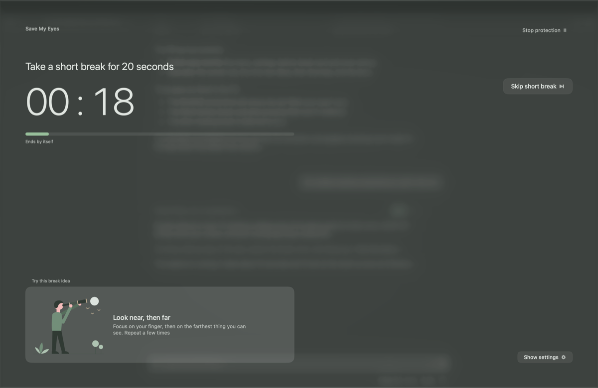
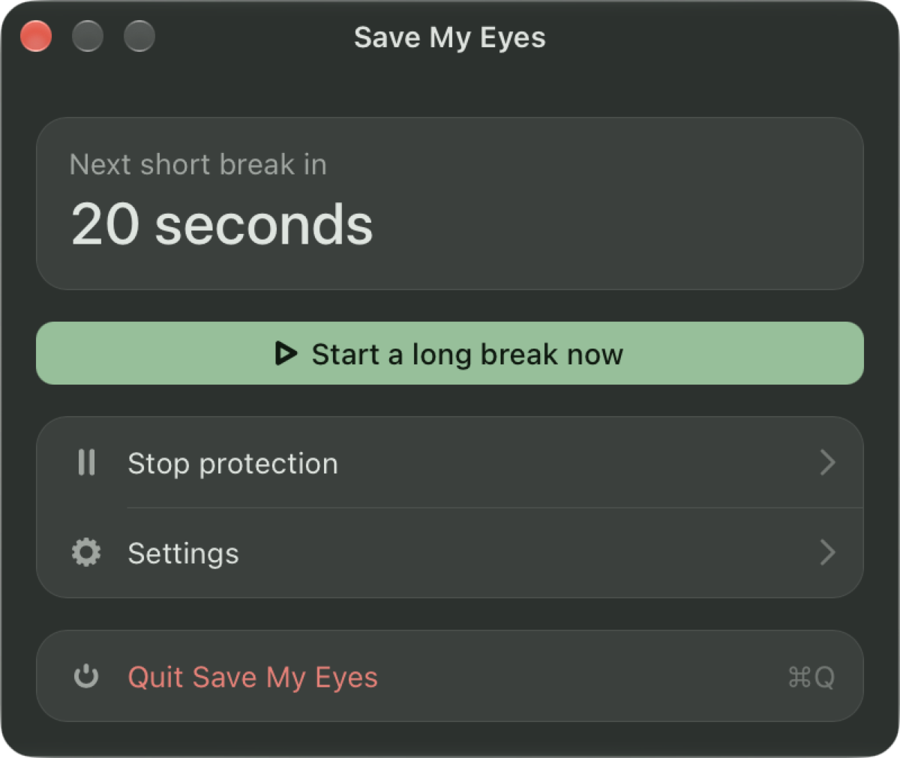

# Save My Eyes

A macOS menu-bar app that covers your screen for 20 seconds every 20 minutes, so you take the eye break you'd otherwise skip.





## Download

[Download for macOS](https://github.com/ammadeo/save-my-eyes/releases/latest)

- Needs macOS 14 or later. Runs on Apple Silicon and Intel Macs.
- Open the download and drag Save My Eyes to Applications.
- Releases so far aren't notarized, so on first launch macOS says it can't verify the app. Click Done, then open System Settings › Privacy & Security and choose Open Anyway.
- Or, in Terminal, run `xattr -dr com.apple.quarantine "/Applications/Save My Eyes.app"` and open the app again.

## What you get

- It starts at login and lives in the menu bar, with no Dock icon.
- You get a 20-second break every 20 minutes, and every third break is a 5-minute one. You can change all three numbers.
- A break covers every display, and you can always skip it with one click.
- From the menu you can see the countdown to your next break, start a long break now, or stop protection for 1, 2 or 3 hours.
- Breaks can wait while a calendar event is on, or while any app is using your camera or microphone, and for 1 more minute after it ends. Both switches are off by default.
- The app only knows that the camera or microphone is in use. It can't see, hear or record anything, and it asks for calendar access only when you turn that switch on.
- It speaks English and Polish.
- It's free and open source. [You can buy me a coffee here](https://www.buymeacoffee.com/ammadeo).

## Development (Swift, Xcode 26+)

Prerequisites: Xcode 26 or later and [xcodegen](https://github.com/yonaskolb/XcodeGen) (`brew install xcodegen`). The Xcode project is generated from `SaveMyEyes/project.yml` and is not committed.

```bash
make project
```

```bash
make build
```

```bash
make test
```

```bash
SME_DEV_EVERY_SECS=8 SME_DEV_OPEN_MENU=1 make run
```

- `make project` writes `SaveMyEyes/SaveMyEyes.xcodeproj`; open it in Xcode to work there. Any `.swift` file added under `SaveMyEyes/Sources` or `SaveMyEyes/Tests` is picked up on the next `make project` (every `make` target runs it).
- `make run` starts a debug build. `SME_DEV_EVERY_SECS=8` makes the first break fire after 8 seconds instead of the configured interval; `SME_DEV_OPEN_MENU=1` (or `settings` / `stop-protection`) opens the menu at startup; `SME_DEV_MICROPHONE=20` makes the microphone read as in use for the first 20 seconds, to see the paused state (pause bars in the menu-bar icon, "Breaks are paused" in the menu) without a real meeting, as long as "Pause breaks while camera or microphone is on" is on (the pause after a meeting then follows, as it would after a real one); `SME_DEV_AUTOSTART=1` lets a debug build register itself as a login item (release builds always do).
- `make release` builds `Save My Eyes.app`. `make dist` builds the universal DMG in `dist/`, and `make install` also puts that build in `/Applications` and starts it.
- `make dist` signs and notarizes the DMG by itself when a Developer ID certificate is on the Mac; otherwise it stays ad-hoc signed and downloads show "Apple could not verify" (see [Signing releases](#signing-releases)).
- Settings are stored as JSON in `~/Library/Application Support/com.ammadeo.savemyeyes/settings.json` (`settings-dev.json` for debug builds), the same file the earlier Tauri build used.
- Layout: `SaveMyEyes/Sources/Core` (settings, scheduler, calendar, device detection, model), `Sources/Windows` (status item popover, before-break panel, break covers, glass material), `Sources/Views` (SwiftUI), `Sources/App` (entry, login item, notification), `Tests` (XCTest).
- Design: [`PRODUCT.md`](PRODUCT.md) records what the app is for, [`DESIGN.md`](DESIGN.md) the visual system (sage on native Liquid Glass, system font, follows the macOS appearance). The history of the Electron → Tauri → Swift rewrites lives in [`docs/migration/`](docs/migration/PLAN.md).

### Signing releases

Only a paid [Apple Developer Program](https://developer.apple.com/programs/) membership can remove the "Apple could not verify" warning from downloaded builds. A free Apple ID can't create the certificate. Setup is once per Mac:

1. In Xcode, open Settings › Accounts, add the Apple ID, then Manage Certificates › + › Developer ID Application.
2. Create an app-specific password at [account.apple.com](https://account.apple.com), then save the notarization login in the keychain:

```bash
xcrun notarytool store-credentials save-my-eyes --apple-id <apple-id> --team-id <team-id>
```

From then on every `make dist` signs with the hardened runtime, notarizes, and staples the ticket to the DMG.

## License

Save My Eyes is licensed under GPL-3.0. See [`LICENSE`](LICENSE).

The break illustrations are by Katerina Limpitsouni ([unDraw](https://undraw.co/)).
